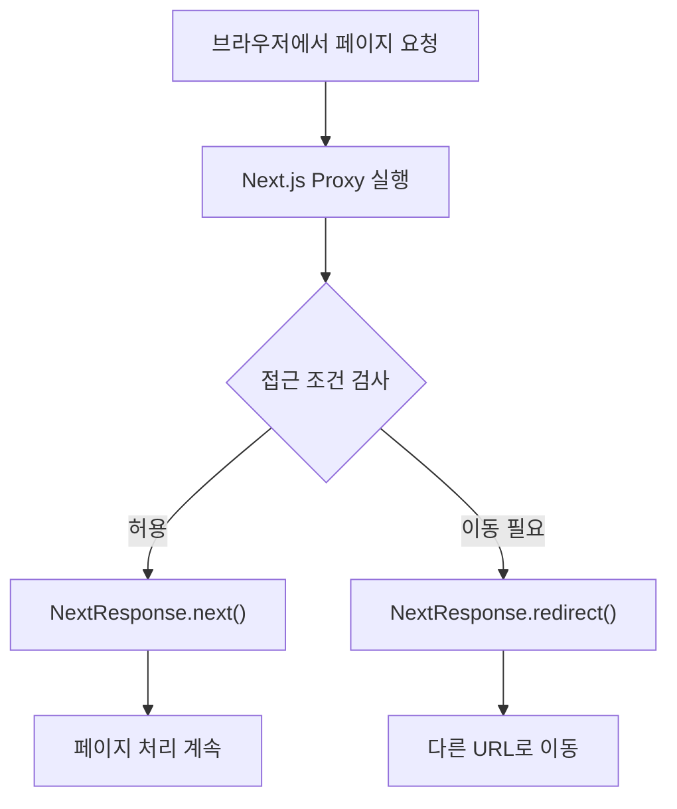

# [Day 7] LG CNS AM Inspire Camp 7기 TIL

작성일: 2026.11.04 (수) | 과목: Next.js / 웹 보안

## 오늘 학습한 주제

**Next.js — CSRF와 Middleware(Proxy)**

- **CSRF**: 로그인된 사용자의 권한을 악용하는 요청 위조 공격과 방어 방법
- **Middleware / Proxy**: 요청이 페이지에 도착하기 전에 로그인 여부 등을 검사하고 처리하는 방법

학습 코드: [CNS7th_Frontend](https://github.com/ROX0124/CNS7th_Frontend) — 2026.11.04 업로드 커밋 `9d023df`, `lgcns-dev-7th-fe/lgcns-fe-next`

## 오늘 배운 것 — 나만의 언어로 설명

### 1. CSRF란?

**CSRF(Cross-Site Request Forgery)는 쉽게 말하면 "다른 사이트가 나의 로그인 상태를 악용해 원하지 않는 요청을 보내게 만드는 공격"이다.**

예를 들어 다음과 같은 상황을 생각해 볼 수 있다.

1. 나는 은행 사이트에 로그인했고 브라우저에 **세션 쿠키**가 남아 있다.
2. 악성 사이트에 접속했는데, 그 사이트가 은행으로 송금 요청을 보내도록 내 브라우저를 유도한다.
3. 쿠키 설정과 서버 보안 검사가 취약하다면, 브라우저가 해당 요청에 은행의 로그인 쿠키를 포함할 수 있다.
4. 은행 서버가 요청의 정당성을 확인하지 않으면, 내가 원하지 않은 송금이 처리될 위험이 있다.

즉, **CSRF는 비밀번호를 훔치는 공격이 아니라 이미 로그인한 사용자의 권한을 악용하는 공격**이다.

#### CSRF를 막는 방법

| 방법 | 초보자 눈높이 설명 |
| --- | --- |
| **CSRF Token** | 서버가 확인할 수 있는 별도의 확인값을 요청에 넣고, 서버가 그 값을 검사한다. |
| **SameSite Cookie** | 다른 사이트에서 시작된 요청에 쿠키가 전달되는 상황을 제한한다. |
| **Origin/Referer 검사** | 요청이 어떤 사이트에서 시작됐는지 서버에서 확인한다. |
| **서버의 권한 검사** | 요청자가 실제로 해당 작업을 할 권한이 있는지 다시 검사한다. |

**CSRF Token은 쉽게 말하면 "이 요청이 정상적으로 시작됐는지 확인하기 위한 검증표"이다.**

단순히 `<input type="hidden">`에 값을 넣는 것으로는 안전해지지 않는다. 서버가 토큰을 발급하고 올바른 값인지 확인해야 한다. 또한 `POST`로 요청을 보낸다는 사실만으로 CSRF를 막을 수 있는 것도 아니다.

> **주의:** CSRF Token, JWT, Session Cookie는 각각 역할이 다르다. CSRF Token은 요청을 검증하는 용도이고, Session Cookie는 로그인 상태를 이어가기 위한 수단이다.

#### 오늘 배운 NextAuth와 CSRF의 관계

오늘 GitHub 프로젝트는 **NextAuth v4**를 사용한다. NextAuth는 로그인·로그아웃 같은 **자체 인증 API**에 CSRF 방어 기능을 제공한다.

- `GET /api/auth/csrf`: 인증 요청에서 사용할 CSRF 확인값 제공
- `POST /api/auth/signin/:provider`: 로그인 요청 처리
- `POST /api/auth/signout`: 로그아웃 요청 처리
- NextAuth는 문서상 **Double Submit Cookie** 방식으로 CSRF를 방어한다. 요청의 확인값과 쿠키를 이용해 검증하는 방식이다.

이번 프로젝트의 `signIn("credentials")`, `signIn("google")`, `signIn("kakao")`는 NextAuth의 로그인 함수를 이용한다. 반면 **개발자가 별도로 만든 모든 API가 자동으로 CSRF 보호를 받는 것은 아니다.**

### 2. Middleware란?

**Middleware(미들웨어)는 쉽게 말하면 "사용자의 요청과 실제 처리 과정 사이에서 공통 작업을 수행하는 코드"이다.**

예를 들어 학교 건물의 출입구에서 출입증을 검사하는 상황과 비슷하다.

- 사용자가 장바구니 페이지를 요청한다.
- 중간 단계에서 로그인 여부를 확인한다.
- 로그인했다면 요청을 통과시키고, 로그인하지 않았다면 로그인 페이지로 보낸다.

인증뿐 아니라 로그 기록, 요청 정보 확인, 헤더 변경 등에도 이러한 중간 처리 개념을 사용할 수 있다.

### 3. Proxy란? 왜 "구 Middleware"라고 부를까?

**Proxy는 일반적으로 요청을 대신 받아 다른 서버나 처리 단계로 중계하는 역할을 뜻한다.**

**Middleware와 Proxy는 일반적인 개념으로는 서로 다른 말이다.** 그런데 **Next.js 16부터 기존 `middleware.ts` 파일 규약의 이름이 `proxy.ts`로 변경되었다.** 그래서 강의에서 "Proxy(구 Middleware)"라고 표현하는 것이다.

| 구분 | 예전 Next.js | 현재 프로젝트의 Next.js 16 |
| --- | --- | --- |
| 파일 이름 | `middleware.ts` | `proxy.ts` |
| 내보내는 함수 이름 | `middleware` | `proxy` |
| 주요 동작 | 페이지 렌더링 전 요청 검사·이동 처리 | 같은 역할을 수행 |

Next.js가 이름을 바꾼 이유는 Express 등의 일반적인 미들웨어와 혼동되는 일을 줄이고, **애플리케이션 앞에서 요청을 처리하는 네트워크 경계의 역할**을 강조하기 위해서다.

따라서 **"모든 미들웨어가 프록시로 바뀌었다"가 아니라 "Next.js의 특정 기능 이름이 바뀌었다"**가 정확하다.

### 4. Next.js Proxy의 작동 원리

**Proxy는 쉽게 말하면 "사용자 요청이 페이지에 도착하기 전에 확인하는 출입문"이다.**



- `NextRequest`: 요청 주소, 경로, 쿠키 등의 정보에 접근할 때 사용하는 객체
- `NextResponse.next()`: 요청을 다음 처리 단계로 통과시킴
- `NextResponse.redirect()`: 다른 주소로 이동하는 응답을 만듦
- `matcher`: 어느 요청에서 Proxy를 실행할지 선택

**중요:** Proxy의 로그인 검사는 **CSRF 방어와 다르다.** CSRF 공격은 이미 로그인한 사용자를 악용할 수 있기 때문에, 로그인 여부를 검사하는 것만으로 막을 수 없다. 또한 실제 데이터 조회·수정에 대한 권한 검사는 서버 API나 Server Action 안에서도 수행해야 한다.

## 오늘 직접 작성한 코드

> 아래 코드는 **11월 4일 GitHub 강의 코드에서 발췌한 복습 대상**이다. 직접 타이핑했다고 가정하지 않고, VS Code에서 다시 작성하며 이해할 코드로 정리했다.

### 1. `proxy.ts` — 로그인 여부에 따른 페이지 이동

경로: `lgcns-fe-next/proxy.ts` (실제 업로드 코드)

```ts
import { NextRequest, NextResponse } from "next/server";
import { getToken } from "next-auth/jwt";
import {
  authUrlList,
  safeCallbackPath,
  withoutAuthUrlList,
} from "./config/initial";

export async function proxy(request: NextRequest) {
  // 요청에 포함된 JWT 정보를 읽는다.
  const token = await getToken({ req: request });
  const accessToken = token?.accessToken;

  // accessToken이 비어 있지 않은 문자열이면 로그인한 것으로 판단한다.
  const loggedIn =
    typeof accessToken === "string" && accessToken.length > 0;

  // 사용자가 요청한 경로를 확인한다.
  const { pathname } = request.nextUrl;

  // 로그인·회원가입 페이지 접근
  if (withoutAuthUrlList.includes(pathname)) {
    if (!loggedIn) return NextResponse.next();

    const callbackUrl = safeCallbackPath(
      request.nextUrl.searchParams.get("callbackUrl")
    );
    return NextResponse.redirect(new URL(callbackUrl, request.url));
  }

  // 회원 전용 페이지에 비로그인 사용자가 접근
  if (authUrlList.includes(pathname) && !loggedIn) {
    const loginUrl = new URL("/login", request.url);
    loginUrl.searchParams.set(
      "callbackUrl",
      `${pathname}${request.nextUrl.search}`
    );
    return NextResponse.redirect(loginUrl);
  }

  // 그 외의 요청은 통과
  return NextResponse.next();
}

export const config = {
  matcher: ["/((?!api|_next/static|_next/image|favicon.ico).*)"],
};
```

#### 한 줄씩 이해해야 하는 부분

| 코드 | 의미 |
| --- | --- |
| `import` | 다른 파일이나 라이브러리에서 기능을 가져옴 |
| `async function proxy` | 비동기 작업(`await`)을 수행할 수 있는 Proxy 함수 |
| `getToken({ req: request })` | 요청에 들어 있는 NextAuth JWT를 읽음 |
| `token?.accessToken` | 토큰이 없으면 오류 대신 `undefined`를 얻음 |
| `pathname` | URL 중 경로 부분. 예: `/cart` |
| `includes(pathname)` | 해당 경로가 배열에 있는지 확인 |
| `!loggedIn` | 로그인이 아닌 상태인지 확인 |
| `redirect` | 다른 URL로 이동 |
| `next` | 요청 통과 |

### 2. 접근 경로 설정

경로: `lgcns-fe-next/config/initial.ts` (핵심 부분)

```ts
const withoutAuthUrlList = ["/login", "/signup"];
const authUrlList = ["/cart", "/order"];
```

- `withoutAuthUrlList`: 로그인하지 않은 사용자가 접근할 수 있는 로그인·회원가입 경로. 이미 로그인했다면 다른 페이지로 이동시킨다.
- `authUrlList`: 로그인한 사용자만 접근하도록 검사하는 경로.

#### 실행 시 예상 결과

| 사용자의 상태 | 요청 URL | Proxy의 예상 결과 |
| --- | --- | --- |
| 비로그인 | `/login` | 통과 |
| 비로그인 | `/cart` | `/login?callbackUrl=%2Fcart`로 이동 |
| 비로그인 | `/order` | `/login?callbackUrl=%2Forder`로 이동 |
| 로그인 | `/login` | 기본적으로 `/`로 이동 |
| 로그인 | `/cart` | 통과 |
| 관계없음 | `/feed` | 통과 |

`matcher`가 `/api` 등을 제외하므로 이 Proxy는 NextAuth의 `/api/auth/...` 요청을 가로채지 않는다. 하지만 **NextAuth 자체의 CSRF 보호 기능은 별개로 작동**한다.

> 이 표는 코드를 읽고 예상한 결과이다. 실제 로그인 동작과 페이지 존재 여부는 실행 환경에서 검증해야 한다. 특히 현재 `authOptions.ts`에는 Credentials 로그인으로 받은 `accessToken`을 JWT에 복사하는 분기가 보이지 않아, 일반 로그인 이후 `loggedIn` 판정은 추가 확인이 필요하다.

### 3. 직접 타이핑할 핵심 코드

전체 코드를 처음부터 외우기보다는 다음 순서로 별도 연습 프로젝트에서 작성해 보자.

```ts
import { NextRequest, NextResponse } from "next/server";

export function proxy(request: NextRequest) {
  const pathname = request.nextUrl.pathname;

  if (pathname === "/cart") {
    return NextResponse.redirect(new URL("/login", request.url));
  }

  return NextResponse.next();
}
```

**코드 예상 결과:** `/cart`는 `/login`으로 이동하고 다른 요청은 통과한다. 통과한 경로에 실제 페이지 파일이 없으면 404가 발생할 수 있다.

## 어려웠던 점 & 해결 과정

### 1. Middleware와 Proxy는 다른데 왜 "구 Middleware"일까?

- **문제:** 일반적인 Middleware와 Proxy가 다른 개념인데 같은 것처럼 보임.
- **시도:** Next.js 16 공식 문서와 실제 `proxy.ts`를 비교함.
- **해결:** Next.js의 **파일 이름과 기능 이름이 변경된 것**이라는 점을 구분함.
- **교훈:** 일반적인 기술 개념과 프레임워크의 공식 명칭을 분리해서 이해해야 한다.

### 2. 로그인 상태만 확인하면 CSRF도 막을 수 있을까?

- **문제:** Proxy도 로그인 여부를 확인하므로 CSRF까지 막을 수 있을 것처럼 생각하기 쉬움.
- **시도:** CSRF 공격이 이미 로그인한 사용자를 악용한다는 점과 `proxy.ts`의 검사 조건을 비교함.
- **해결:** Proxy는 **로그인 여부**, CSRF 방어는 **요청의 정당성**을 확인한다는 차이를 이해함.
- **교훈:** 로그인 검사는 CSRF 방어를 대신하지 못한다.

### 3. 코드에서 헷갈리는 부분

- **문제:** `NextResponse.next()`와 `redirect()`, `loggedIn`과 `!loggedIn`의 의미가 낯설 수 있음.
- **시도:** 각각을 "통과/이동", "로그인/비로그인"으로 해석하여 분기를 따라가 봄.
- **해결:** 요청한 URL과 로그인 상태를 표로 만들어 예상 결과를 확인함.
- **교훈:** 복잡한 `if`문은 조건을 하나씩 읽고 예상 결과를 적으면 이해하기 쉽다.

## AI와 함께한 부분 (선택)

- **물어본 것:** CSRF와 Middleware(Proxy)를 처음 배우는 사람도 이해하도록 설명하고, 11월 4일 GitHub 실습 코드를 TIL 양식에 맞춰 정리해 달라고 요청함.
- **AI 답 중 검증한 것:** `proxy.ts`, `config/initial.ts`, `authOptions.ts`의 실제 코드를 대조했고, CSRF와 Next.js Proxy 개념은 공식 문서를 참고함.
- **AI가 틀렸던 것 / 주의할 점:** 이전 정리에서 NextAuth·Login·Session이 중심이었지만 실제 오늘의 필기 주제는 **CSRF와 Middleware(Proxy)**임을 반영해 수정함. 실제 인증 테스트는 수행하지 않았으므로 실행 결과를 확정하지 않음.

참고: [OWASP CSRF 예방](https://cheatsheetseries.owasp.org/cheatsheets/Cross-Site_Request_Forgery_Prevention_Cheat_Sheet.html) · [NextAuth v4 REST API](https://next-auth.js.org/getting-started/rest-api) · [Next.js 16 Proxy](https://nextjs.org/docs/app/api-reference/file-conventions/proxy)

## 내일 계획 & 아직 모르는 것

### 직접 복습할 내용 (약 30분)

1. **5분 — CSRF 설명:** "로그인한 사용자", "쿠키", "악성 사이트", "원하지 않는 요청" 네 단어를 사용해 CSRF를 설명한다.
2. **10분 — Proxy 재타이핑:** 위의 간단한 `proxy` 함수를 직접 입력하고 각 줄에 주석을 달아 본다.
3. **10분 — 실제 코드 읽기:** GitHub의 `proxy.ts`를 열어 `getToken`, `loggedIn`, `pathname`, `redirect`, `matcher`를 찾아본다.
4. **5분 — 예상 결과 확인:** 로그인하지 않은 사용자가 `/cart`에 들어갈 때 어떤 `if`문이 실행되는지 설명한다.

### 아직 흐릿한 것

- CSRF Token과 Session Token은 무엇이 다를까?
- `getToken()`으로 읽은 JWT는 어떤 방식으로 로그인 상태를 나타낼까?
- `matcher`를 사용하지 않으면 어떤 요청들까지 Proxy가 실행될까?
- Proxy에서 로그인 확인을 한 후에도 서버 API에서 권한을 다시 확인해야 하는 이유는 무엇일까?

### 오늘 배운 내용 한 줄 요약

**CSRF는 로그인된 사용자의 요청을 위조하는 공격이고, Next.js Proxy는 요청이 페이지에 도착하기 전에 로그인 상태를 검사하고 이동 여부를 결정하는 기능이다. 두 기능은 서로 대체할 수 없다.**
